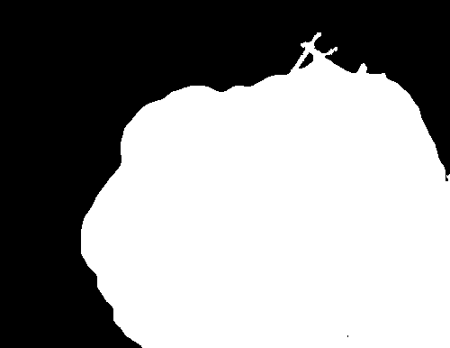
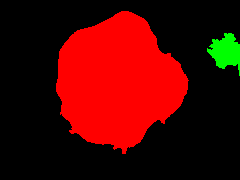

# 🍽️ FoodVisionAI

**AI-based food image analysis using computer vision and deep learning.**

## 📌 Project Overview

FoodVisionAI is a computer vision project designed to analyze food images using artificial intelligence.

The objective is to explore how deep learning and image segmentation techniques can be used to identify food items and analyze meal images.

The project focuses on image-based food recognition and segmentation, with the possibility of comparing meal images before and after consumption.

## 🎯 Objectives

- Explore food image recognition using deep learning.
- Experiment with the MobileNetV3 architecture.
- Analyze and segment food images.
- Visualize segmentation masks.
- Compare food images before and after a meal.

## 🛠️ Technologies

- **Python** – Main programming language.
- **MobileNetV3** – Deep learning architecture for image classification.
- **Computer Vision** – Image processing and analysis.
- **Image Segmentation** – Identification and visualization of image regions.
- **Git & GitHub** – Version control and project management.

## 📁 Project Structure

```text
FoodVisionAI/
│
├── dataset/
│   └── UECFoodPixComplete/
│
├── images/
│   └── repas.jpg
│
├── results/
│   ├── masque_306_visualisation.png
│   └── masque_336_couleurs.png
│
├── src/
│   ├── analyse_repas.py
│   ├── classification_test.py
│   └── verification_masque.py
│
├── .gitignore
└── README.md
```

## 🔬 Current Progress

The project is currently in development.

Work completed so far:

- Dataset exploration and preparation.
- Initial food image analysis.
- Inspection and verification of segmentation masks.
- Visualization of segmentation results.
- Initial Python scripts for image analysis and classification experiments.

## 🚀 Future Improvements

- Implement and evaluate MobileNetV3 for food recognition.
- Improve food segmentation.
- Develop before-and-after meal image comparison.
- Integrate the different components into a complete image analysis pipeline.
- Evaluate model performance.

## 👩‍💻 Author

**Arame Diop**

Master's student in Computer Science  
Université de Montpellier

[GitHub Profile](https://github.com/Arame-10)

---

*Academic and personal project exploring artificial intelligence and computer vision.*

## 🖼️ Visual Results

### Segmentation mask – Image 306



### Segmentation mask – Image 366


